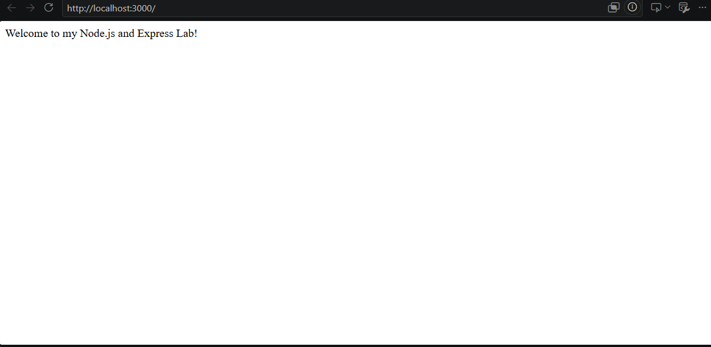
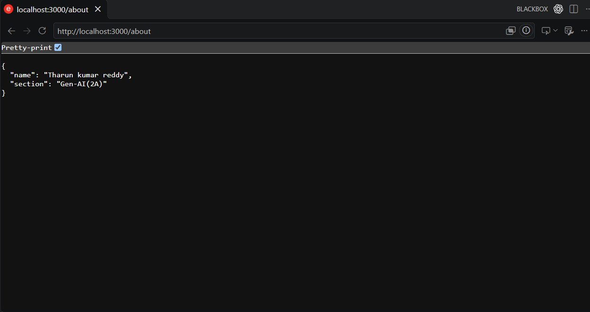
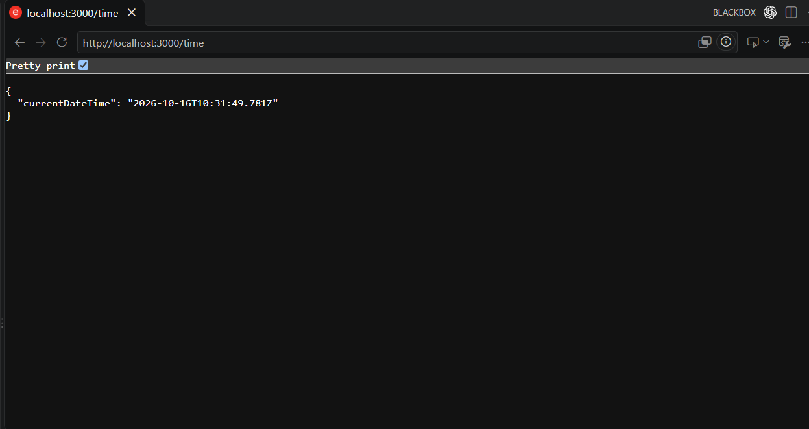
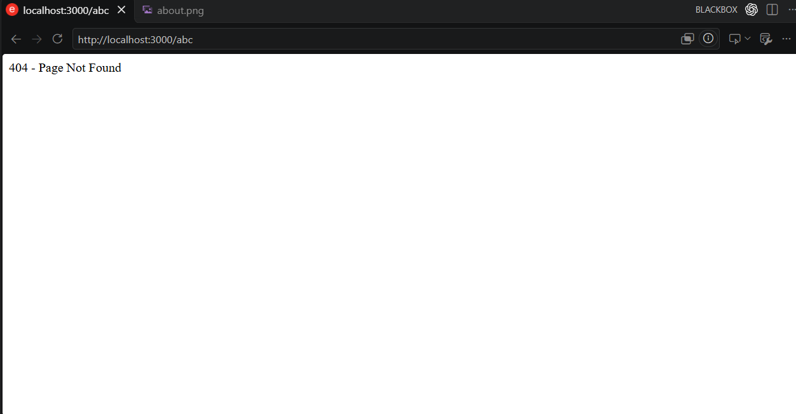

# Lab 1: Node.js and Express Server

**Name:** Tharun Kumar Reddy  
**Registration Number:** 252U1R9028  
**Section:** Gen-AI 2A

## Live Link

[https://dealsbe.com/](https://backend-eight-mocha-72.vercel.app/)

## Project Description

A simple web server built using Node.js and Express.js. It provides welcome, about, and current-time routes, along with a 404 handler for unknown routes.

## How to Run

### 1. Install Dependencies

```bash
npm install
```

### 2. Start the Server

```bash
node server.js
```

### 3. Open in Browser

http://localhost:3000

## Endpoints

| Method | Path | Description | Status Code |
|--------|------|-------------|-------------|
| GET | `/` | Welcome message | 200 |
| GET | `/about` | Name and section in JSON | 200 |
| GET | `/time` | Current date and time | 200 |
| GET | `/unknown` | Not found response | 404 |

## Screenshots

### 1. Home Route



### 2. About Route



### 3. Time Route



### 4. 404 Response



## Notes

Implemented the required routes using Express.js and tested their HTTP status codes.

## Technologies Used

- Node.js
- Express.js
- JavaScript
- Git and GitHub
