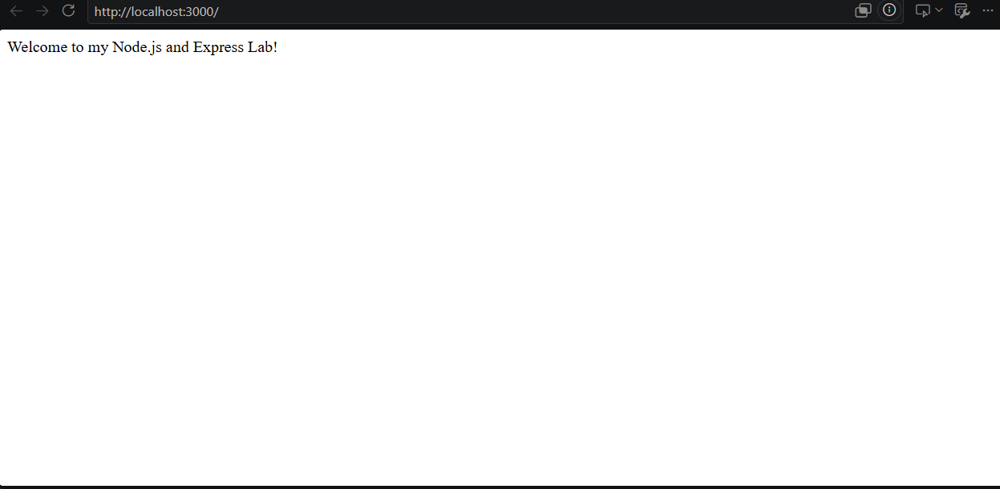
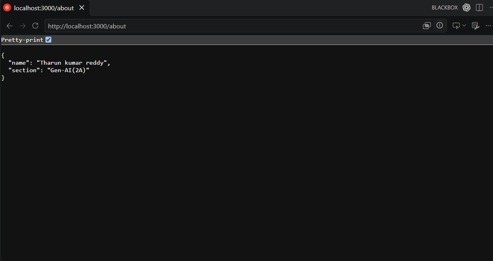
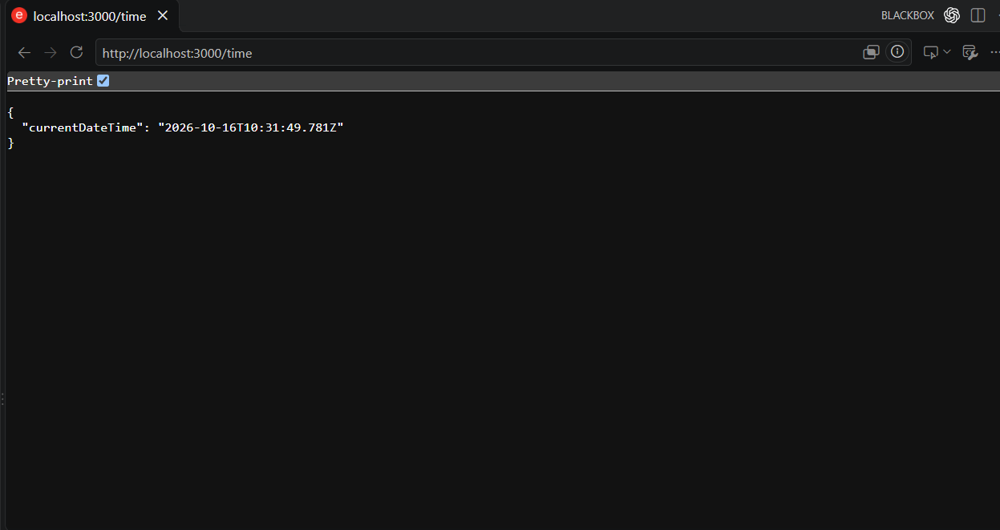
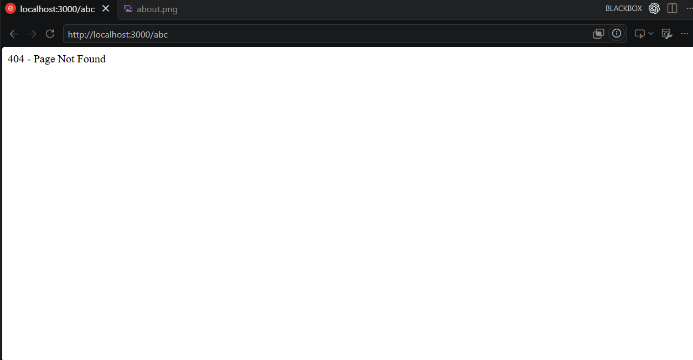

# Lab 1: Node.js and Express Server

**Name:** Tharun Kumar Reddy  
**Registration Number:** 252U1R9028  
**Section:** Gen-AI 2A

## Live Link

https://backend-4aid.vercel.app/

## Project Description

A simple web server built using Node.js and Express.js. It provides welcome, about, and current-time routes, along with a 404 handler for unknown routes.

## How to Run

### 1. Install Dependencies

```bash
npm install
```

### 2. Start the Server

```bash
node server.js
```

### 3. Open in Browser

```text
http://localhost:3000
```

## Endpoints

| Method | Path | Description | Status Code |
|--------|------|-------------|-------------|
| GET | `/` | Welcome message | 200 |
| GET | `/about` | Name and section in JSON | 200 |
| GET | `/time` | Current date and time | 200 |
| GET | `/unknown` | Not found response | 404 |

## Screenshots

### 1. Home Route



### 2. About Route



### 3. Time Route



### 4. 404 Response



## Notes

Implemented the required routes using Express.js and tested their HTTP status codes.

## Technologies Used

- Node.js
- Express.js
- JavaScript
- Git and GitHub

## Viva Questions and Answers

### 1. What is the difference between package.json and node_modules?

**package.json:**
- It contains project information, scripts, and dependencies required by the Node.js project.
- It specifies which packages are needed for the project.

**node_modules:**
- It is a folder that contains the actual installed packages and libraries used by the project.
- It is created when we install dependencies using `npm install`.

**Example:** `package.json` lists Express.js as a dependency, while `node_modules` contains the installed Express.js package.

### 2. What does app.listen do?

`app.listen()` starts the Express server and makes it listen for incoming requests on a specified port.

**Example:**

```javascript
app.listen(3000, () => {
    console.log("Server running on port 3000");
});
```

Here, the server starts on port 3000 and waits for client requests.

### 3. What do request and response represent?

**Request (req):**
- It represents the request sent by the client (browser) to the server.
- It contains information about the incoming request.

**Response (res):**
- It represents the response sent by the server back to the client.
- It is used to send data, messages, and status codes.

**Example:**

```javascript
app.get("/", (req, res) => {
    res.send("Welcome to my server!");
});
```

Here:
- `req` represents the incoming request from the browser.
- `res.send()` sends a welcome message back to the browser.

---

**End of Lab 1**
