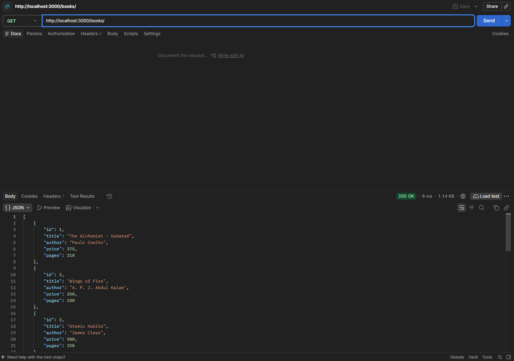
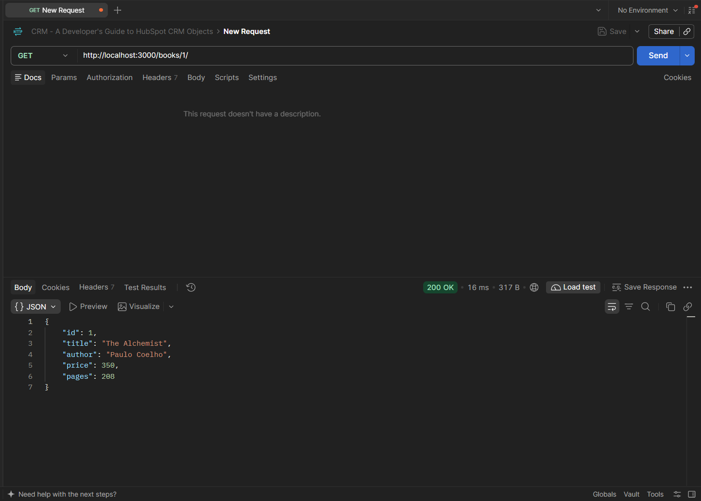
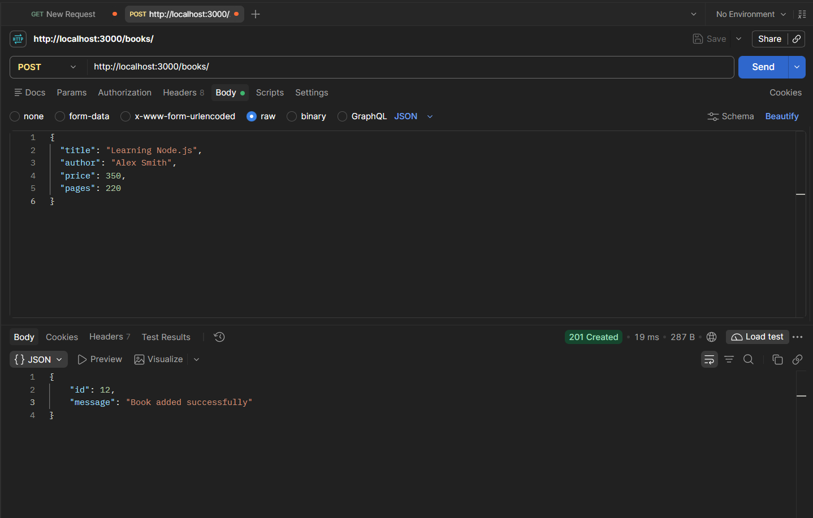
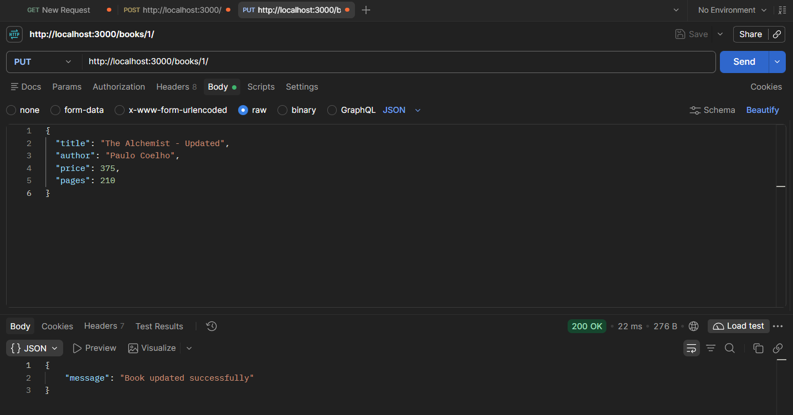
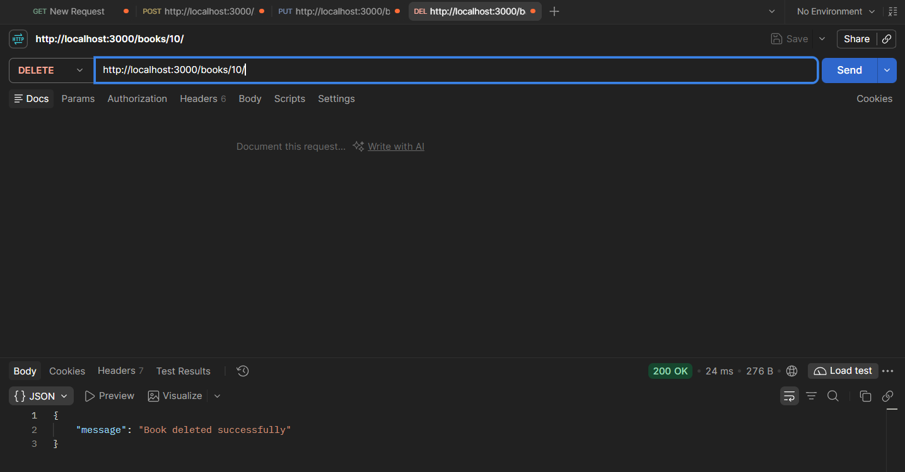
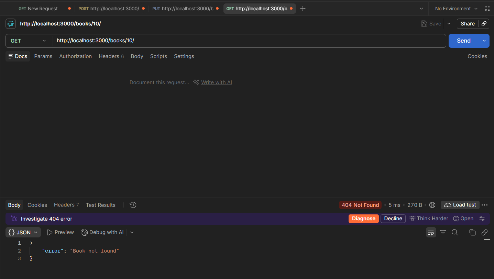

# Lab 2: Book Management API

**Name:** Tharun Kumar Reddy  
**Registration Number:** 252U1R9028  
**Section:** Gen-AI 2A

## Project Description

This project is a Book Management API built using Node.js and Express.js. It stores book data in SQLite and supports CRUD operations such as adding, listing, fetching by ID, updating, and deleting books.

## How to Run

### 1. Install Dependencies

```bash
npm install
```

### 2. Start the Server

```bash
npm run dev
```

### 3. Open in Browser / Postman

```text
http://localhost:3000
```

## API Endpoints

| Method | Path | Description | Status Code |
|--------|------|-------------|-------------|
| GET | `/books` | Retrieve all books | 200 |
| GET | `/books/:bookId` | Retrieve a single book by ID | 200 |
| POST | `/books` | Add a new book | 201 |
| PUT | `/books/:bookId` | Update an existing book | 200 |
| DELETE | `/books/:bookId` | Delete a book by ID | 200 |

## Screenshots

### 1. Get All Books



### 2. Get Single Book



### 3. Add Book (POST)



### 4. Update Book (PUT)



### 5. Delete Book



### 6. Database Verification



## Notes

- The API uses SQLite for persistent book storage.
- All SQL queries are executed using parameterized statements.
- The project was tested using Postman for each CRUD operation.

## Technologies Used

- Node.js
- Express.js
- SQLite
- sqlite
- sqlite3
- Postman
- Git and GitHub
