# Lab 3: REST API, Query Parameters, Validation & Debugging

## Student Details

- **Name:** Your Name
- **Registration Number:** Your Registration Number
- **Section:** Your Section
- **Course:** Backend Development Fundamentals

## Objective

To develop a RESTful API for managing books with search, sorting, pagination, price filtering, request validation, appropriate HTTP status codes, and debugging.

## Technologies Used

- Node.js
- Express.js
- SQLite
- Postman
- JavaScript

## Installation and Setup

### 1. Clone the repository

```bash
git clone YOUR_GITHUB_REPOSITORY_URL
```

### 2. Navigate to the project folder

```bash
cd lab-03
```

### 3. Install dependencies

```bash
npm install
```

### 4. Configure environment variables

Create a `.env` file if required by your project.

Example:

```env
PORT=3000
```

Add any database configuration required by your project.

### 5. Start the server

```bash
npm run dev
```

Server URL:

`http://localhost:3000`

## API Endpoints

| Method | Endpoint | Description |
|---|---|---|
| GET | `/books` | Retrieve all books |
| GET | `/books/:id` | Retrieve a book by ID |
| POST | `/books` | Add a new book |
| PUT | `/books/:id` | Update an existing book |
| DELETE | `/books/:id` | Delete a book |

### Query Parameters

The GET `/books` endpoint supports:

- `search_q` – Search books by title.
- `order_by` – Sort using a selected field.
- `order` – ASC or DESC.
- `limit` – Maximum number of records.
- `offset` – Number of records to skip.
- `min_price` – Minimum price filter.
- `max_price` – Maximum price filter.

## Request Validation

- Rejects requests with missing titles.
- Rejects requests with missing authors.
- Rejects non-numeric prices.
- Returns HTTP 400 for invalid input.

## HTTP Status Codes

- **200 OK:** Successful retrieval, update or deletion.
- **201 Created:** Book successfully created.
- **400 Bad Request:** Invalid request data.
- **404 Not Found:** Requested book does not exist.

## Screenshots

All screenshots are available in the `screenshots/` folder.

### 1. Server Running
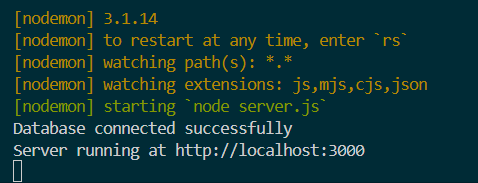

### 2. GET All Books
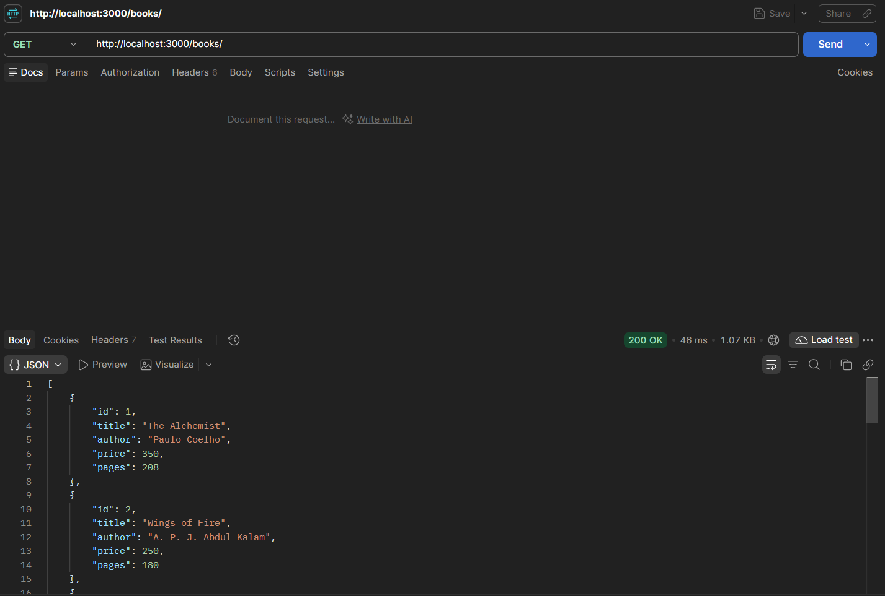

### 3. Search Books
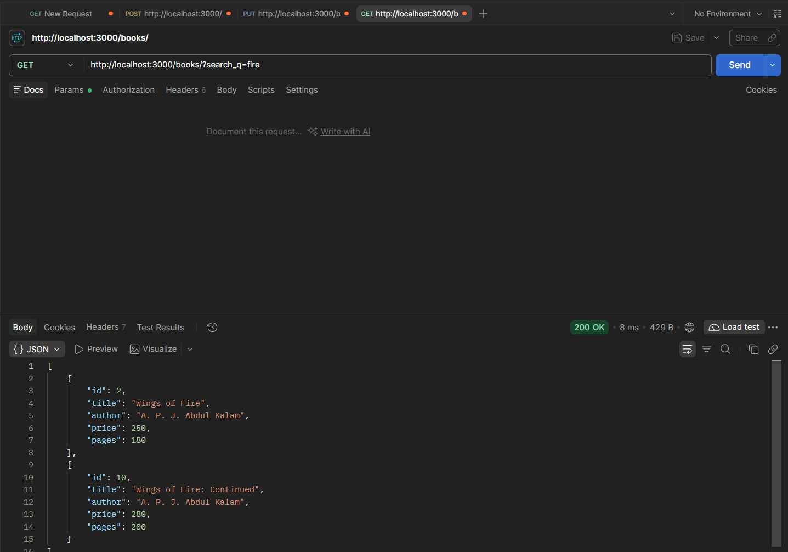

### 4. Sort Books
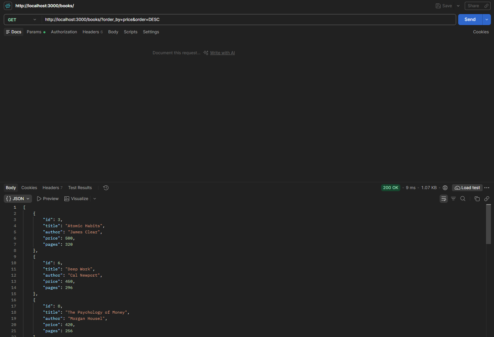

### 5. Pagination
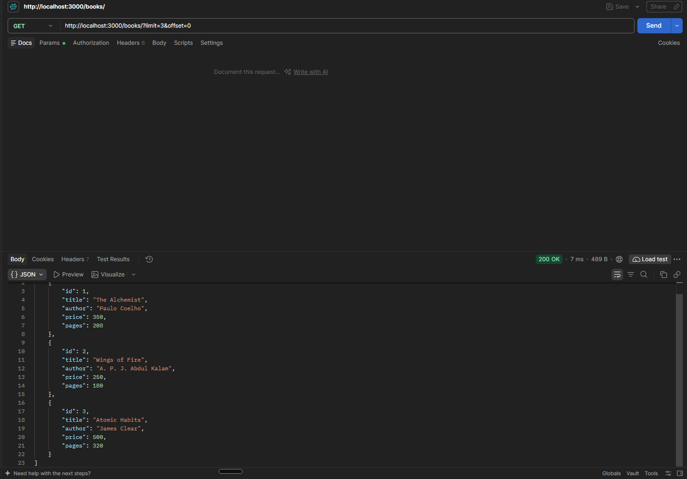

### 6. Price Filter
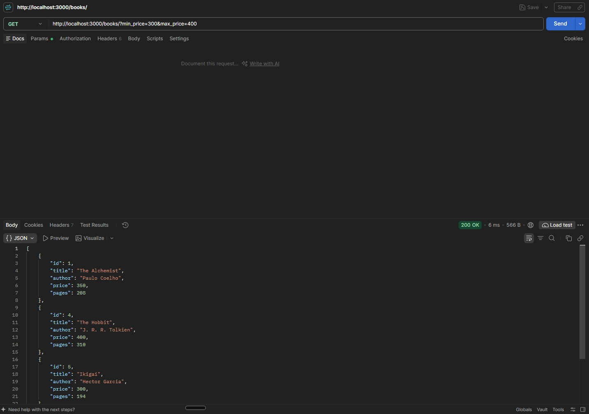

### 7. Combined Query Parameters
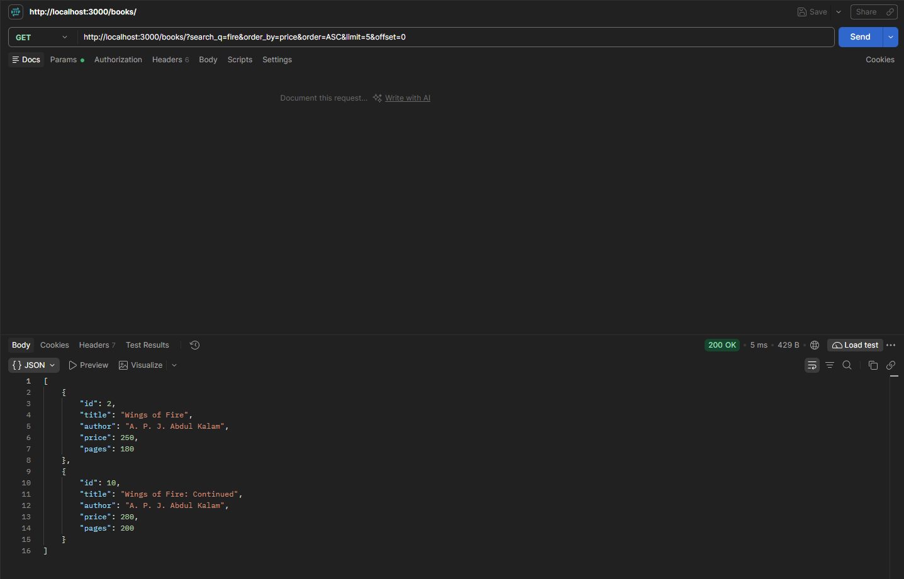

### 8. Missing Title Validation
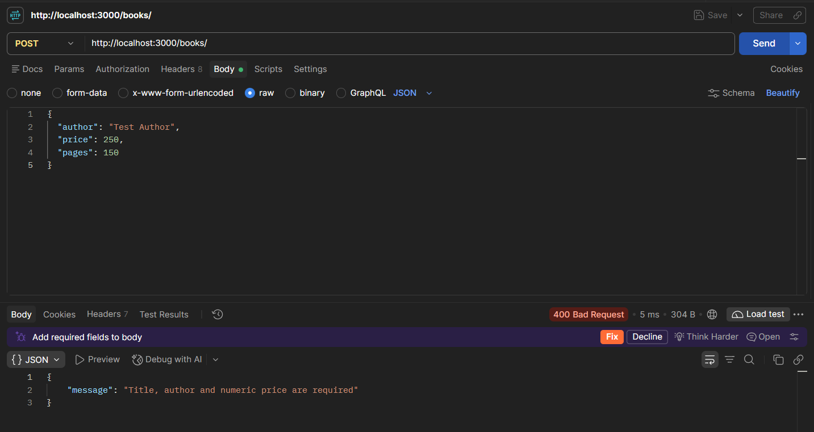

### 9. Invalid Price Validation
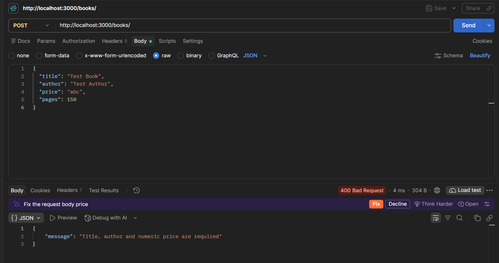

### 10. Create Book
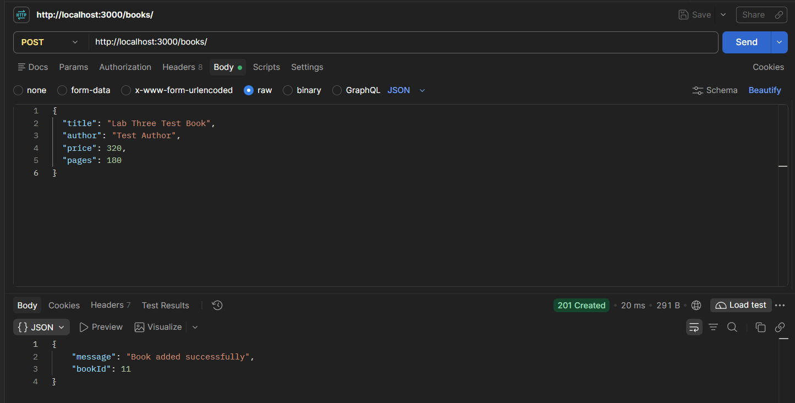

### 11. Update Book
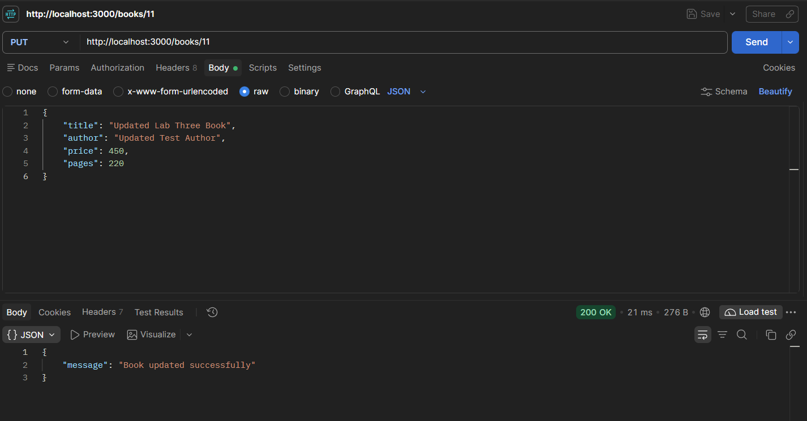

### 12. Delete Book
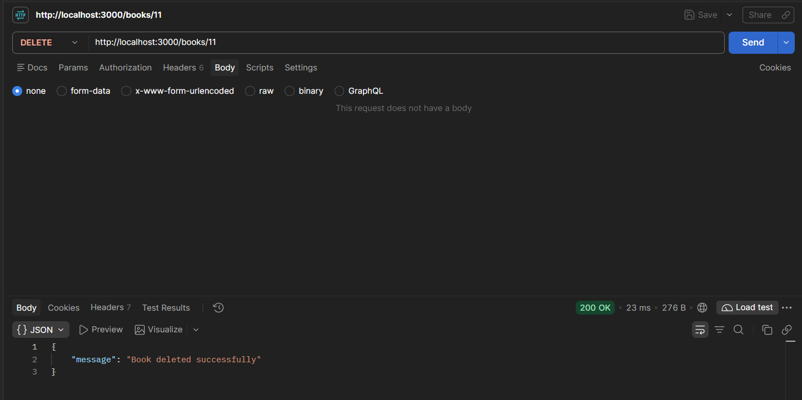

### 13. Book Not Found
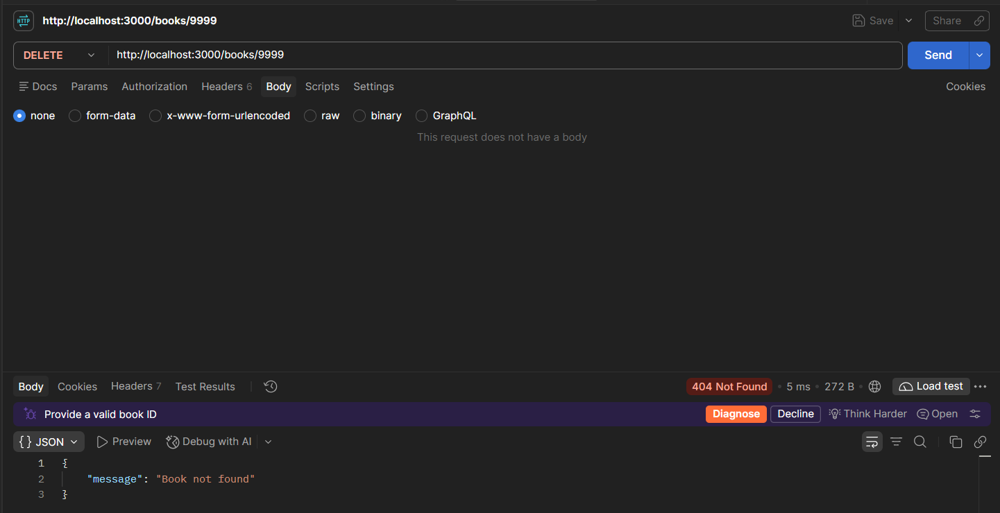

## Debugging and Problems Faced

- **Port Conflict:** Resolved the EADDRINUSE error by identifying the process using the required port.
- **Wrong Import Path:** Corrected the import path to connect the required files.
- **Table Name Error:** Corrected the database table name.
- **Missing Await:** Added await to handle asynchronous database operations correctly.

## Conclusion

Successfully developed a RESTful Book Management API with search, sorting, pagination, price filtering, validation, and appropriate HTTP status codes. Tested the API using Postman and documented the outputs using screenshots.